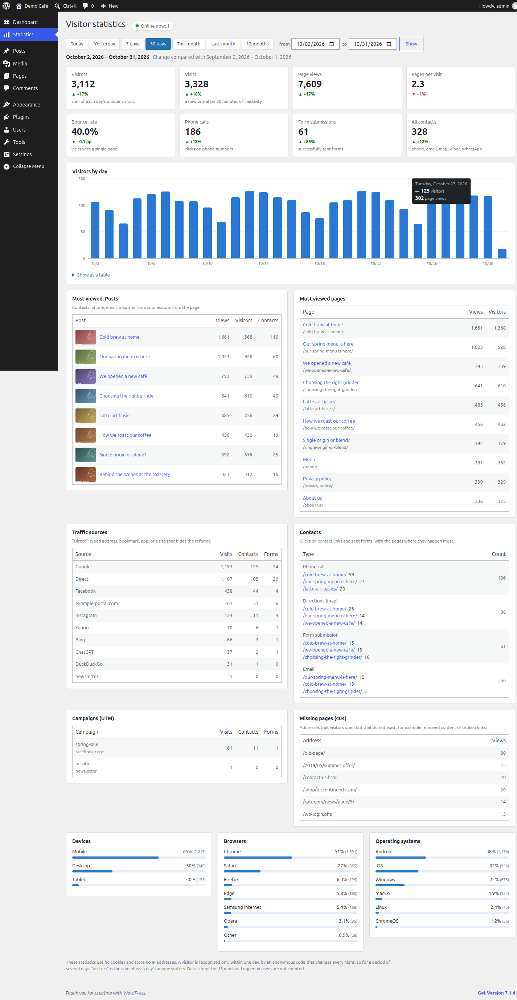
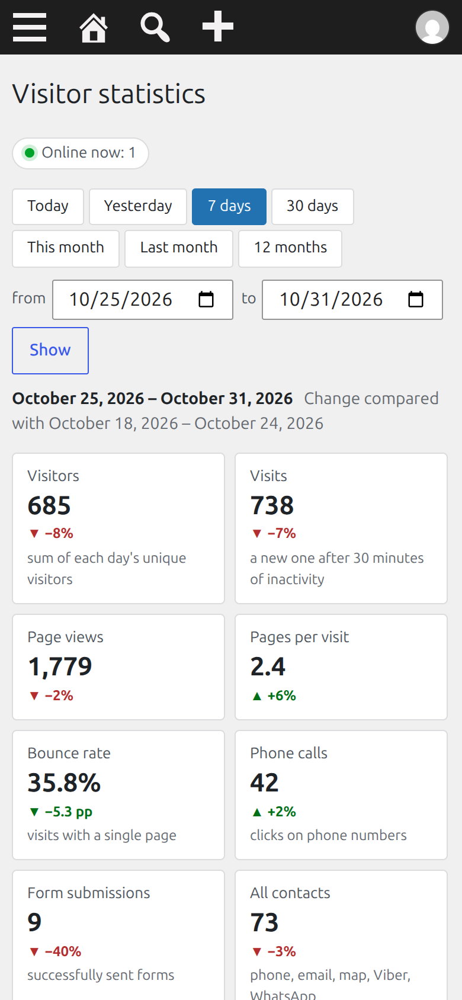
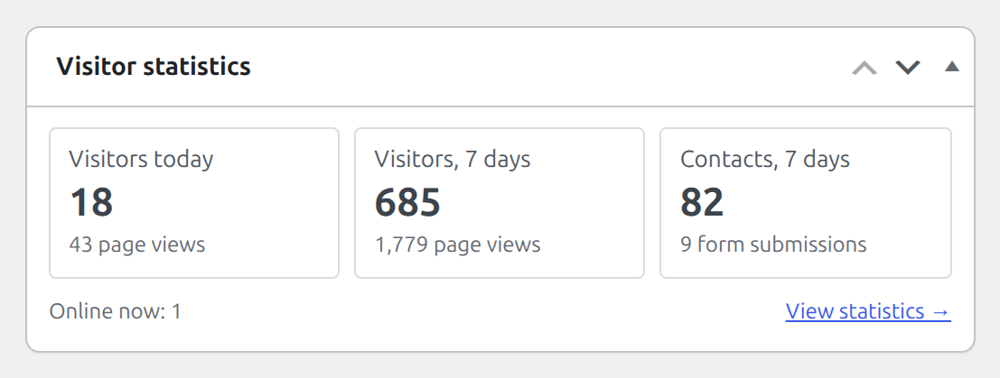
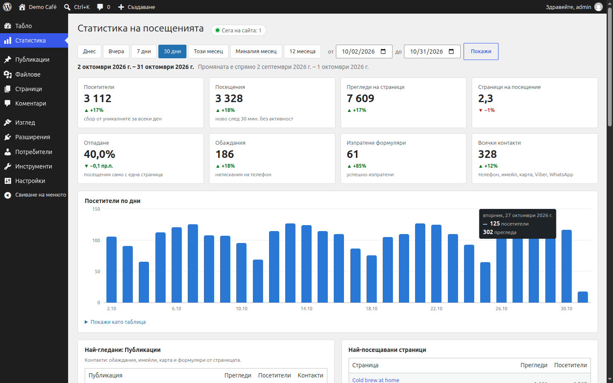

# Free Analytics

Cookieless visitor statistics for WordPress, stored in your own database. No third-party services, no IP addresses stored, and a dashboard in wp-admin.

Free Analytics counts visitors, page views, traffic sources, clicks on contact links (phone, e-mail, map, Viber, WhatsApp) and successful form submissions. It does this with a small deferred script that sends one request per page view to your own site. It sets no cookies and uses no browser storage, and it is designed so that no personal data is stored. Whether that means you can count visitors without a consent banner depends on your jurisdiction and your setup, so check with your own legal advice (see the [FAQ](#faq)).

- [Screenshots](#screenshots)
- [Features](#features)
- [How it works and the privacy model](#how-it-works-and-the-privacy-model)
- [Caching and hosting](#caching-and-hosting)
- [Requirements](#requirements)
- [Installation](#installation)
- [Usage](#usage)
- [Developer reference](#developer-reference): [filters](#filters), [JavaScript API](#javascript-api), [WP-CLI](#wp-cli), [REST endpoint](#rest-endpoint), [database](#database)
- [Uninstall](#uninstall)
- [Translations](#translations)
- [Development and tests](#development-and-tests)
- [FAQ](#faq)
- [License](#license)

## Screenshots

<p align="center">
  
  <br>
  <sub>Dashboard (desktop)</sub>
</p>

<table>
  <tr>
    <td align="center" valign="top">
      
      <br>
      <sub>Dashboard on a phone (390 px)</sub>
    </td>
    <td align="center" valign="top">
      
      <br>
      <sub>wp-admin home widget</sub>
    </td>
    <td align="center" valign="top">
      
      <br>
      <sub>Bulgarian translation</sub>
    </td>
  </tr>
</table>

## Features

**Numbers**

- Visitors, visits, page views, pages per visit and bounce rate, each with the change against the previous period of the same length.
- Online now: visitors seen in the last 5 minutes.
- A chart of visitors by hour (one day), by day (2 to 92 days) or by month (longer), with page views in the tooltip and a "Show as a table" view. The bars are keyboard focusable.
- Period presets (Today, Yesterday, 7 days, 30 days, This month, Last month, 12 months) and a custom date range.

**Content**

- "Most viewed" for every public post type (posts, products, custom post types), with thumbnails and the contacts and forms that came from each page. Pages, media and page-builder templates are left out of these cards; the `free_analytics_featured_post_types` filter changes that.
- Most viewed pages by path.
- A 404 report: addresses that visitors open but that do not exist.

**Traffic**

- Sources with names for search engines (Google, Bing, DuckDuckGo, Yahoo, Yandex, Brave Search, Ecosia), social networks (Facebook, Instagram, X, TikTok, YouTube, LinkedIn), AI assistants (ChatGPT, Perplexity, Claude, Gemini), Gmail, and the host name for any other referrer. Everything without a referrer is "Direct".
- Google Ads clicks (`gclid`, `gbraid`, `wbraid`) and Facebook clicks (`fbclid`, and the Facebook and Instagram in-app browsers) are recognised even when the referrer is missing.
- UTM campaigns (`utm_source`, `utm_medium`, `utm_campaign`) with their visits, contacts and forms.
- Contacts and forms are attributed to the source of the visit they happened in.

**Conversions**

- Contact clicks: `tel:`, `mailto:`, Google Maps, Viber and WhatsApp links are detected automatically, including middle-clicks.
- Successful form submissions from Bricks, Contact Form 7, Elementor Pro, WPForms, Gravity Forms and Fluent Forms. Only the form's ID is recorded, never its content. Other forms can report through the [JavaScript API](#javascript-api).

**Audience and admin**

- Devices, browsers and operating systems.
- A widget on the wp-admin home screen: visitors today, visitors in 7 days, contacts in 7 days, online now.
- WP-CLI: `wp free-analytics summary` and `wp free-analytics prune`.
- Translations: a POT file and a bundled Bulgarian (`bg_BG`) translation. Dates and numbers follow the admin language.

## How it works and the privacy model

1. On public pages, for visitors who are not logged in, WordPress loads `assets/js/tracker.js` (about 4 KB, deferred, in the footer). A small inline config carries the REST URL, the post ID and a 404 flag; it is the same for every visitor of a URL.
2. The script sends the page view with `navigator.sendBeacon` (with a `fetch` fallback) as a `POST` to `/wp-json/free-analytics/v1/hit`. Clicks on contact links and form successes are sent the same way.
3. The server validates the payload, classifies the user agent and referrer into a few labels, and writes one row to the table `{prefix}free_analytics_hits`.

### The visitor code

```
visitor = first 16 hex characters of HMAC-SHA256( IP | user agent | site host, salt of the day )
```

- The salt is 32 random bytes per day (site timezone), kept in the option `free_analytics_salt_<Y-m-d>`.
- The previous day's salt is deleted as soon as the first hit of the new day creates the new one, and in any case by the daily clean-up (about 03:30 site time). Once it is gone, nobody, including the site owner, can tell whether two days' visitors were the same person. Until it is deleted, someone with access to your database could test whether a known IP and user agent visited that day.
- Because of this there is no tracking across days. For a period of several days, "Visitors" is the **sum of each day's unique visitors**: a person who comes on two days counts twice.
- The IP is `REMOTE_ADDR` only. `X-Forwarded-For` is set by the client and is not trusted. See [Caching and hosting](#caching-and-hosting).

### What is stored

One row per page view or event:

| Column | Content |
|---|---|
| `ts`, `day` | Time of the hit and its date, in the site timezone |
| `visitor` | The 16-hex visitor code above |
| `visit` | A random 16-hex ID per visit. A visit ends after 30 minutes of inactivity; a page view that arrives with a different external source (ad, search, social, campaign) also starts a new visit. |
| `event` | `pageview`, `tel`, `email`, `map`, `viber`, `whatsapp` or `form` |
| `path` | The page path, decoded, without query string or fragment, at most 255 characters |
| `post_id`, `post_type`, `is_404` | Post ID and type (only for published, viewable posts) and a 404 flag |
| `target` | For contact events: the dialled number (digits and `+`), the e-mail address from the `mailto:` link, or `Google Maps`, `Viber`, `WhatsApp`. For forms: the form's ID. |
| `source`, `medium`, `campaign` | Traffic source label, `utm_medium`, `utm_campaign`; copied from the visit's first hit, so events can be grouped by source |
| `device`, `browser`, `os` | Class and names derived from the user agent, for example `mobile`, `Chrome`, `Android` |

The `target` of a contact event is the contact detail on your own page (your phone number, your e-mail address). If a page links to other people's numbers or addresses, those are stored as well.

### What is never stored

- The IP address and the user agent string (both are only used in memory to compute the visitor code and the labels above).
- Cookies, `localStorage` or anything else in the visitor's browser: the plugin sets and reads nothing there.
- Query strings, other than `utm_source`, `utm_medium` and `utm_campaign`, and URL fragments.
- The referrer URL: only a source label or the referrer's host name.
- Form field content, user accounts or logins, screen size, language or location.

### What is not counted

- Logged-in users. The script is not loaded for them, and the endpoint also ignores requests that carry a valid login cookie, so staff who open a cached page are not counted either.
- Admin pages, previews, the customizer, feeds, `robots.txt`, and the editors and previews of Bricks, Divi, Beaver Builder, Elementor, Oxygen and Breakdance.
- Bots: requests without a browser-like user agent (no `Mozilla/`, or shorter than 20 characters) and user agents of crawlers, link-preview fetchers, uptime monitors, HTTP libraries and headless browsers are dropped with a `204` and nothing is stored. Browsers that report `navigator.webdriver` do not send anything.
- Floods: at most 30 rows per visitor code per minute; more gets a `429`.
- Requests from other sites: a request whose `Origin` host differs from the site's host (ignoring `www.`), or that has `Sec-Fetch-Site: cross-site`, gets a `403`.

The endpoint is public by design (anonymous visitors, cached pages, no nonce). A script that sends the right headers can still add fake page views; the checks above only filter casual abuse.

### Retention

Rows older than 13 months are deleted once a day by WP-Cron (the event `free_analytics_daily`, about 03:30 site time, together with old salts). Change the period with the [`free_analytics_retention_months`](#free_analytics_retention_months) filter. If you disabled WP-Cron, run `wp free-analytics prune` from a system cron.

## Caching and hosting

Free Analytics works with full-page caches (WP Rocket, LiteSpeed Cache, W3 Total Cache, WP Super Cache, Cloudflare page caching, nginx FastCGI cache and similar):

- The inline config is per URL (REST URL, post ID, 404 flag) and contains no nonce or per-visitor value, so a cached page is correct for everyone.
- The beacon is a `POST`, and the endpoint answers with `Cache-Control: no-store`, so it is never cached.
- **WP Rocket:** "Delay JavaScript execution" would hold the script back until the first click or scroll, so visitors who leave without one would not be counted. The plugin adds `free-analytics` and `freeAnalyticsConfig` to `rocket_delay_js_exclusions` automatically.
- **LiteSpeed Cache, Perfmatters, FlyingPress** and other optimizers with a delay-JS feature: add `free-analytics` and `freeAnalyticsConfig` to their delay-JS exclusions by hand.
- **Security and REST plugins:** logged-out visitors must be able to `POST` to the REST route `free-analytics/v1/hit` (`/wp-json/free-analytics/v1/hit`, or `?rest_route=/free-analytics/v1/hit` with plain permalinks). Do not let a firewall or a "disable REST API" plugin block it.
- **Real client IP:** PHP must see the visitor's address in `REMOTE_ADDR`. Behind a reverse proxy or CDN, configure the web server to restore it (`mod_remoteip` on Apache, the `real_ip` module on nginx, using the header your proxy sets). Otherwise all visitors with the same user agent are merged into one. The dashboard shows a warning when, on the request that loads it, `REMOTE_ADDR` is a private or reserved address and an `X-Forwarded-For` header is present. It cannot detect a CDN whose public addresses reach PHP, so check this yourself on such setups.
- **Form tracking with jQuery-based plugins:** Elementor Pro, WPForms, Gravity Forms and Fluent Forms report through jQuery events. The beacon binds to them as soon as jQuery is available: when it runs, after the page has loaded, or on the first interaction if an optimiser delays jQuery until then.

## Requirements

- WordPress 6.5 or newer
- PHP 8.1 or newer
- MySQL or MariaDB. The plugin uses MySQL-specific SQL (`GET_LOCK`, `INSERT IGNORE`, `DELETE ... LIMIT`, `DATE_FORMAT`, multi-column `COUNT(DISTINCT ...)`), so SQLite-based setups are not supported.
- A reachable REST API for logged-out visitors, and WP-Cron (or a system cron) for the daily clean-up.

## Installation

**From a release**

1. Download `free-analytics.zip` from the [Releases](https://github.com/katsar0v/free-analytics/releases) page. Use the attached `free-analytics.zip`, not "Source code (zip)": GitHub names the folder in that archive after the tag, and the folder must be called `free-analytics`.
2. In wp-admin go to Plugins -> Add New Plugin -> Upload Plugin, choose the file and activate.

**From git**

```bash
cd wp-content/plugins
git clone https://github.com/katsar0v/free-analytics.git free-analytics
```

The folder must be named `free-analytics`. The clone also contains `tests/` and `docs/`; they are not needed on a production site.

There is no setup step. The table is created on the first request after activation.

**Updates:** the plugin header has `Update URI: false`, so WordPress will not offer updates for it, and will not offer an update from an unrelated wordpress.org plugin with the same slug. To update, download the new release and upload it over the old one (WordPress offers "Replace current with uploaded"). Your data is kept. Do not use Delete in wp-admin for an update, because that [removes the data](#uninstall).

## Usage

Open **Statistics** in the wp-admin menu. Pick a period at the top, or enter a custom range and press Show. The page shows the numbers, the chart, and the tables.

| Metric | Meaning |
|---|---|
| Visitors | Unique visitors per day, summed over the period |
| Visits | A visit ends after 30 minutes of inactivity, or when a page view arrives with a different external source |
| Page views | Number of page views |
| Pages per visit | Page views divided by visits |
| Bounce rate | Share of visits that consist of exactly one hit, and that hit is a page view. A visit with a page view and a phone click is not a bounce. |
| Phone calls | Clicks on `tel:` links |
| Form submissions | Successfully sent forms |
| All contacts | Phone, e-mail, map, Viber and WhatsApp clicks |

The statistics page and the home-screen widget need the `manage_options` capability by default; see [`free_analytics_capability`](#free_analytics_capability).

If no data shows up, open a public page of your site in a private window (logged out) and look at the network tab. A `POST` to `.../free-analytics/v1/hit` should return `204`.

| Result | Meaning |
|---|---|
| No request at all | The script was not loaded: you are logged in, a cache plugin delays or removes it, or the [`free_analytics_track`](#free_analytics_track) filter turned it off. |
| `403`, empty body | The request's `Origin` host is not the site's host (for example the site is also reachable under another domain), or it came from another site. |
| `400`, empty body | The payload was not accepted. |
| `429`, empty body | More than 30 rows per minute from one visitor code. |
| Any answer with a body (HTML or a JSON error) | A firewall or a REST plugin blocks the route. The plugin's own answers never have a body. |

## Developer reference

### Filters

#### `free_analytics_track`

Whether the beacon is loaded on the current page. Default `true`. It runs while the page is rendered, so with a page cache the result is cached per URL: base it on the page, not on cookies or other per-visitor state. It runs after the built-in checks (logged-in users, previews, feeds, page-builder editors).

```php
// Do not count the thank-you page.
add_filter( 'free_analytics_track', function ( $track ) {
	return is_page( 'thank-you' ) ? false : $track;
} );
```

#### `free_analytics_capability`

The capability needed to see the Statistics page and the dashboard widget. Default `manage_options`.

```php
// Editors can see the statistics too.
add_filter( 'free_analytics_capability', function () {
	return 'edit_others_posts';
} );
```

#### `free_analytics_featured_post_types`

The post types that get their own "Most viewed" card. Default: all public post types except `page`, `attachment` and the template types of page builders and the block editor (`bricks_template`, `elementor_library`, `et_pb_layout`, `fl-builder-template`, `ct_template`, `oxy_user_library`, `breakdance_template`, `breakdance_header`, `breakdance_footer`, `wp_block`, `wp_template`, `wp_template_part`, `wp_navigation`). A card appears only when the type has views in the period. Only published, viewable posts are recorded with their post type.

```php
// Products and posts only.
add_filter( 'free_analytics_featured_post_types', function () {
	return array( 'product', 'post' );
} );

// Also give pages their own card.
add_filter( 'free_analytics_featured_post_types', function ( $types ) {
	$types[] = 'page';
	return $types;
} );
```

#### `free_analytics_item_subtitle`

A muted second line under each item in the "Most viewed" cards, for example a price. Parameters: `string $subtitle` (default `''`) and `WP_Post $post`. The result is stripped of HTML tags and escaped, so return plain text. For posts that are not published, ` · not published` is appended.

```php
// WooCommerce: show the product price.
add_filter( 'free_analytics_item_subtitle', function ( $subtitle, $post ) {
	if ( 'product' === $post->post_type && function_exists( 'wc_get_product' ) ) {
		$product = wc_get_product( $post->ID );
		if ( $product ) {
			return html_entity_decode( wp_strip_all_tags( $product->get_price_html() ), ENT_QUOTES, 'UTF-8' );
		}
	}
	return $subtitle;
}, 10, 2 );

// A custom post type with a "price" custom field.
add_filter( 'free_analytics_item_subtitle', function ( $subtitle, $post ) {
	$price = get_post_meta( $post->ID, 'price', true );
	return '' !== $price ? number_format_i18n( (float) $price, 0 ) . ' EUR' : $subtitle;
}, 10, 2 );
```

#### `free_analytics_retention_months`

How many months of statistics are kept. Default `13`, minimum `1`. Used by the daily clean-up, by `wp free-analytics prune` and by the note at the bottom of the dashboard.

```php
add_filter( 'free_analytics_retention_months', function () {
	return 24;
} );
```

#### `rocket_delay_js_exclusions` (hooked by the plugin)

Not a filter of this plugin. The plugin adds `free-analytics` and `freeAnalyticsConfig` to WP Rocket's "Delay JavaScript execution" exclusions. For another optimizer, add the same two patterns in its settings.

### JavaScript API

The beacon exposes `window.freeAnalytics.track( event, target )` for events that the automatic detection does not cover, for example a form that none of the supported plugins handles, or a contact link that is added by script. It returns `true` when the event was sent and `false` when the event name is not allowed.

Allowed events: `tel`, `email`, `map`, `viber`, `whatsapp`, `form`. Page views cannot be sent through the API.

| Event | `target` | Stored |
|---|---|---|
| `tel` | The link, starting with `tel:` | The number: digits and `+` only, at most 20 characters |
| `email` | The link, starting with `mailto:` | The address, at most 100 characters |
| `map` | A Google Maps URL (`google.*/maps`, `maps.google.*`, `maps.app.goo.gl`, `goo.gl/maps`) | `Google Maps` |
| `viber` | The link, starting with `viber:` | `Viber` |
| `whatsapp` | `whatsapp:`, or an `https` link to `wa.me`, `api.whatsapp.com` or `web.whatsapp.com` | `WhatsApp` |
| `form` | A form ID (any string) | The ID without characters outside `A-Za-z0-9_.:-`, at most 40 characters |

For the contact events the server checks that the link matches the event; if it does not, the request is rejected with `400` and nothing is stored. The object exists only where the beacon is loaded (not for logged-in users), so guard the call.

```js
document.querySelector( '#newsletter' ).addEventListener( 'submit', function () {
	window.freeAnalytics && window.freeAnalytics.track( 'form', 'newsletter' );
} );

window.freeAnalytics && window.freeAnalytics.track( 'tel', 'tel:+15550100' );
```

### WP-CLI

```bash
wp free-analytics summary [--from=<date>] [--to=<date>] [--format=<format>]
wp free-analytics prune
```

- `summary` prints the totals, the events and the top 10 pages. `--from` and `--to` are `Y-m-d` dates in the site timezone; `--to` defaults to today and `--from` to 6 days before `--to`. `--format` is `table` (default) or `json`; any other value is an error. The JSON has the keys `from`, `to`, `totals`, `top_pages`, `sources` and `online`.
- `prune` deletes rows older than the retention period and old salts, and prints how many rows it deleted.

```bash
wp free-analytics summary --from=2026-10-01 --to=2026-10-31 --format=json
```

### REST endpoint

`POST /wp-json/free-analytics/v1/hit`, public, no body in the response, always with `Cache-Control: no-store`. The body is JSON (sent as `text/plain` to avoid a CORS preflight) of at most 2048 bytes.

| Status | Meaning |
|---|---|
| `204` | Recorded, or silently ignored (bot, logged-in user) |
| `400` | Invalid payload |
| `403` | Request from another origin |
| `429` | Rate limit (30 rows per visitor per minute) |

Payload keys: `e` event, `p` path (`location.pathname`), `id` post ID, `nf` 404 flag, `r` referrer, `us`, `um`, `uc` UTM source, medium and campaign, `ck` click ID kind (`g` or `f`), `t` link or form ID.

### Database

One table, `{prefix}free_analytics_hits`, created and upgraded with `dbDelta` when the plugin loads and its schema version is behind.

| Column | Type |
|---|---|
| `id` | `bigint(20) unsigned`, auto increment, primary key |
| `ts` | `datetime` (site timezone) |
| `day` | `date` (site timezone) |
| `visitor` | `char(16)` |
| `visit` | `char(16)` |
| `event` | `varchar(16)`, default `pageview` |
| `path` | `varchar(255)` |
| `post_id` | `bigint(20) unsigned`, default 0 |
| `post_type` | `varchar(20)` |
| `is_404` | `tinyint(1) unsigned` |
| `target` | `varchar(100)` |
| `source` | `varchar(100)` |
| `medium` | `varchar(50)` |
| `campaign` | `varchar(100)` |
| `device` | `varchar(10)` |
| `browser` | `varchar(20)` |
| `os` | `varchar(20)` |

Indexes: `day_event (day, event)`, `visitor_ts (visitor, ts)`, `visit (visit)`, `post_day (post_id, day)`.

Options: `free_analytics_db_version` (not autoloaded) and one `free_analytics_salt_<Y-m-d>` (not autoloaded; normally only today's exists). Cron event: `free_analytics_daily`.

## Uninstall

- **Deactivating** keeps all data and removes only the daily clean-up event.
- **Deleting** the plugin in wp-admin (or `wp plugin uninstall free-analytics`) drops the table `{prefix}free_analytics_hits`, deletes every option whose name starts with `free_analytics_` (including the salt), and clears the cron event. On multisite this is not tested and only affects the site it runs for.

## Translations

The text domain is `free-analytics`. The plugin ships a POT file (`languages/free-analytics.pot`) and a Bulgarian translation (`bg_BG`, as `.po`, `.mo` and `.l10n.php`). It is loaded from the plugin's `languages/` folder and follows the user's admin language.

To add a language:

```bash
cd wp-content/plugins/free-analytics
wp i18n make-pot . languages/free-analytics.pot --slug=free-analytics   # only if the strings changed
cp languages/free-analytics.pot languages/free-analytics-de_DE.po       # then translate it and set the Language header
wp i18n make-mo languages
wp i18n make-php languages
```

`make-php` creates the `.l10n.php` file that WordPress 6.5 and newer load faster than the `.mo`. Pull requests with new translations are welcome.

## Development and tests

Layout:

```
free-analytics.php     plugin header, loader, deactivation hook
uninstall.php          drops the table and options
inc/                   clock, schema, classify, fingerprint, recorder, tracker,
                       stats, cron, admin_page, cli
assets/js/tracker.js   the front-end beacon
assets/js/admin.js     chart tooltip on the dashboard
assets/css/admin.css   dashboard styles
languages/             POT, bg_BG
tests/                 test suite and seed tool
```

**Tests** run with WP-CLI on a **development** site, never on production:

```bash
wp eval-file wp-content/plugins/free-analytics/tests/run.php [filter]
```

The optional filter is a substring of a case name, for example `recorder` or `stats: top`. The exit status is 1 when a case fails. The suite does not need the plugin to be active. It works in a sandbox: it creates tables with the prefix `fatest_` in the same database (copies of the options, users and usermeta tables, empty posts, its own hits table), freezes the plugin clock, fakes the request through `$_SERVER` and the home URL, drops the `fatest_` tables at the end (also after a fatal error), and finally checks that the real hits table and the real `free_analytics_*` options are unchanged. The database user therefore needs `CREATE` and `DROP` rights.

**Seed tool** (development only; it writes to the real hits table):

```bash
wp eval-file wp-content/plugins/free-analytics/tests/tools/seed.php [days|clean]
```

Without an argument it fills the table with 60 days of fake traffic built from your published content, so the dashboard has something to show. A number (1 to 400, for example `45`) seeds that many days instead; `clean` removes the seeded rows and nothing else.

**Release zip:** `.gitattributes` keeps `tests/`, `docs/` and the CI files out of archives, so this produces a clean install package with the right folder name:

```bash
git archive --format=zip --prefix=free-analytics/ -o free-analytics.zip v1.0.0
```

The GitHub workflow in `.github/workflows/lint.yml` runs `php -l` on every PHP file for PHP 8.1 to 8.4 and checks that the Bulgarian `.po` compiles.

## FAQ

**Do I need a cookie banner?**
The plugin sets no cookies, uses no browser storage, and is designed so that no personal data is stored: it keeps no IP address and no user agent string, and the visitor code cannot be linked across days. Whether the counting therefore needs consent or a mention in your privacy policy depends on the law that applies to you and on how you configure the rest of your site (other plugins, embeds, a CDN that logs IP addresses). Check with your own legal advice. This is not legal advice.

**Why is "Visitors" over several days a sum?**
The salt behind the visitor code changes every day and the old one is deleted, so the plugin cannot know that a visitor of Monday is the same person as a visitor of Tuesday. A period's "Visitors" is the sum of each day's unique visitors. In the hourly chart of a single day, a visitor who is active in two different hours appears in both bars.

**How is a visit defined?**
A new visit starts after 30 minutes of inactivity, or when a page view arrives with a different external source than the current visit (for example an ad click while a search visit is open). A reload, "back" or an internal click does not start a new visit.

**Does it slow my site down?**
The script is about 4 KB (smaller compressed), loaded deferred in the footer, and sends one small `POST` per page view with `sendBeacon`, so it does not block rendering. On the server each hit runs a handful of small indexed queries and answers `204` without a body.

**Does it work with page caches and CDNs?**
Yes, see [Caching and hosting](#caching-and-hosting).

**Does it honour Do Not Track or Global Privacy Control?**
It does not read these signals.

**Why are my pages all shown as `/`?**
With plain permalinks (`/?p=123`) the stored path has no query string, so pages cannot be told apart in "Most viewed pages". Use pretty permalinks. The "Most viewed" cards per post type use the post ID and are not affected.

**Are the device, browser and OS exact?**
They come from the user agent only. For example, iPadOS Safari reports a Mac user agent, so those iPads are counted as desktop macOS.

**Which timezone is used?**
The site timezone (Settings -> General) at the time of recording. Days, hours and "today" follow it.

**Multisite?**
Not tested. The table name uses the prefix of the current site, and uninstall only cleans the site it runs for.

**Can I export the data?**
Use `wp free-analytics summary --format=json` for the totals, or query the table `{prefix}free_analytics_hits` directly.

## License

GPL-2.0-or-later. See [LICENSE](LICENSE).
